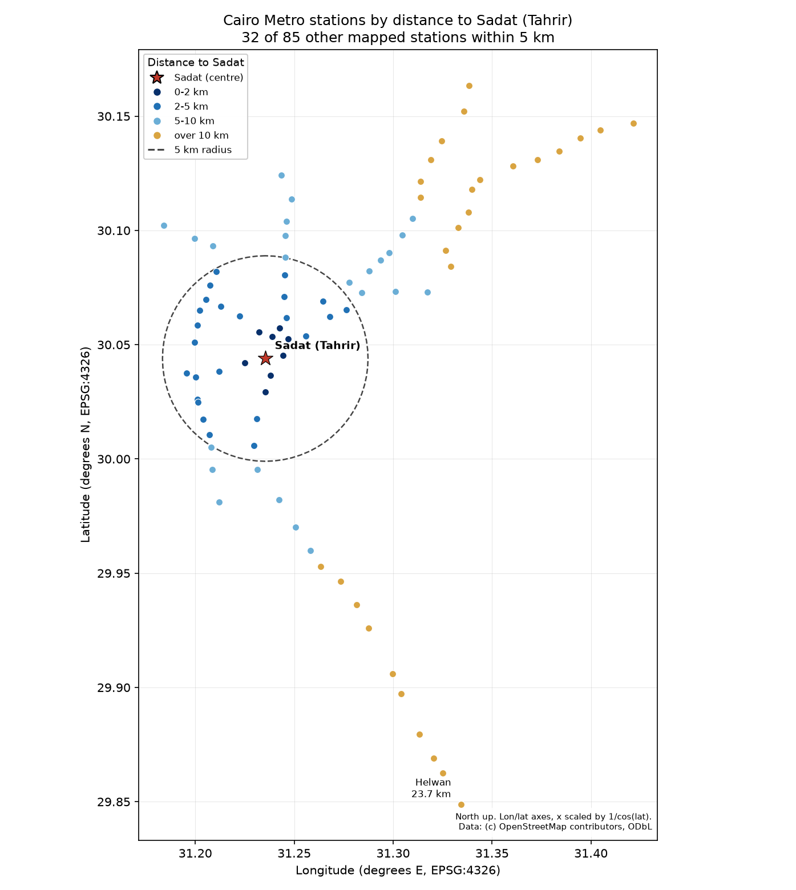

<p align="center">
  <picture>
    <source media="(prefers-color-scheme: dark)" srcset="assets/brand/logo-dark.svg">
    
  </picture>
</p>

# csv-to-geojson

Part of [OpenTerra](https://github.com/AmmarYasser455), a family of open GIS tools.
Turn a CSV with coordinates into GeoJSON. It auto-detects the latitude and longitude
columns, understands several coordinate formats, and reports the rows it could not parse
instead of silently dropping them. No dependencies beyond the Python standard library.

[](https://colab.research.google.com/github/AmmarYasser455/csv-to-geojson/blob/main/examples/demo.ipynb)
· [Demo map](https://ammaryasser455.github.io/csv-to-geojson/)

## Why

Spreadsheets exported from field tools, portals and GPS loggers use `lat`, `Latitude`,
`LNG`, `y`, semicolon delimiters, decimal commas or degrees-minutes-seconds. This tool
normalises all of that into a valid GeoJSON FeatureCollection and tells you exactly which
lines were skipped and why.

## Install

```
pip install git+https://github.com/AmmarYasser455/csv-to-geojson
```

## Command line

```
$ csv-to-geojson examples/cities.csv -o docs/demo.geojson
lat column: latitude, lon column: longitude; 8 features, 0 rows skipped
```

Options: `--lat`, `--lon` (explicit columns), `--delimiter`, `--encoding`, `--strict`
(exit status 1 if any row was skipped), `--rejects FILE` (write the skipped rows as JSON:
`line`, `reason`, original `values`; an empty list when nothing was skipped), `-o` (default: stdout). Exit status 2 means the
file could not be converted at all. `python -m csv_to_geojson` works too.

Skipped rows are reported on stderr:

```
$ csv-to-geojson messy.csv
lat column: lat, lon column: lon; 1 features, 2 rows skipped
  line 3: lat: lat out of range [-90, 90]: 95.0
  line 4: lat: not a coordinate: 'abc'
```

## Python

```python
>>> from csv_to_geojson import convert_file, convert
>>> result = convert_file("examples/cities.csv")
>>> result.lat_column, result.lon_column
('latitude', 'longitude')
>>> result.geojson["features"][0]
{'type': 'Feature', 'geometry': {'type': 'Point', 'coordinates': [31.2357, 30.0444]}, 'properties': {'city': 'Cairo', 'country': 'Egypt'}}
>>> r = convert("name;lat;lon\nCairo;30,0444;31,2357\nNowhere;95;10\n")
>>> len(r.geojson["features"]), [(e.row, e.reason) for e in r.errors]
(1, [(3, 'lat: lat out of range [-90, 90]: 95.0')])
```

`parse_coordinate(text, axis)` and `detect_columns(fieldnames)` are also public.

## Detection and formats

- Latitude names: `lat`, `latitude`, `y`, `lat_deg`, ...; longitude: `lon`, `lng`, `long`,
  `longitude`, `x`, ... (case-insensitive). Use `--lat/--lon` otherwise.
- Values: `30.0444`, `30,0444`, `33.8688 S`, `W 0.1278`, `30°02'39.8"N`, `−33.8688` (typographic minus U+2212).
- Delimiter: the most frequent of `, ; tab |` in the header line.

## Demo, notebook, example data

- Map: <https://ammaryasser455.github.io/csv-to-geojson/> (`docs/`, static Leaflet page;
  `docs/demo.geojson` is the tool's output for the example and is checked by a test).
- Notebook: [examples/demo.ipynb](examples/demo.ipynb).
- Data and its source: [examples/README.md](examples/README.md).

## Showcase

Real data: 86 Cairo Metro station nodes from OpenStreetMap, converted with this tool and
measured against Sadat (Tahrir) station.



Report, web map, notebook and GeoJSON: [showcase/](showcase/README.md).

## Limitations

- Output is WGS 84 (EPSG:4326) in `[longitude, latitude]` order as GeoJSON requires. Input
  is assumed to already be WGS 84 degrees; projected coordinates (e.g. UTM metres) are
  rejected as out of range or, if small enough, wrongly accepted. No reprojection.
- Only point geometries from two coordinate columns; no WKT, single "lat,lon" column or
  elevation column.
- Column detection is by header name only. A file whose lat/lon columns are swapped
  under misleading names is not detected, except that values beyond ±90 in latitude are reported.
- Properties are kept as strings (no type inference). Whole file is read into memory.
- Rows with a valid latitude but invalid longitude are skipped entirely.
- Rows with more fields than the header (e.g. unquoted decimal commas) are reported and skipped.
- A sign combined with a hemisphere letter (`-30 N`) is rejected; use either `-30` or `30 S`.
- `--lat` / `--lon` match a header exactly, or else ignoring case and surrounding spaces
  (`--lat LATITUDE` finds `latitude`) when that is unambiguous.
- `--lat` / `--lon` may be given alone; the other axis is then auto-detected among the
  remaining columns. Giving the same column for both is an error.
- Duplicate header names are rejected, and so is a header with more than one candidate
  column for an axis (e.g. `x,y,lat,lon` or `lat,latitude`); choose with `--lat/--lon`.
- Rows with fewer fields than the header are reported and skipped. DMS needs unit marks
  (`30°15'20"`); bare `30 15 20` is rejected rather than guessed. Minutes-only or
  seconds-only values (`45′`) are rejected; write `0°45′`.
- Only physically blank (empty or whitespace-only) lines are ignored. A record whose
  fields are all empty (`,`) or a quoted empty record (`""`) is reported as a bad row. Malformed quoting (e.g. an unterminated `"`) stops the whole
  conversion with an error instead of merging records.

## License

MIT, see [LICENSE](LICENSE).
