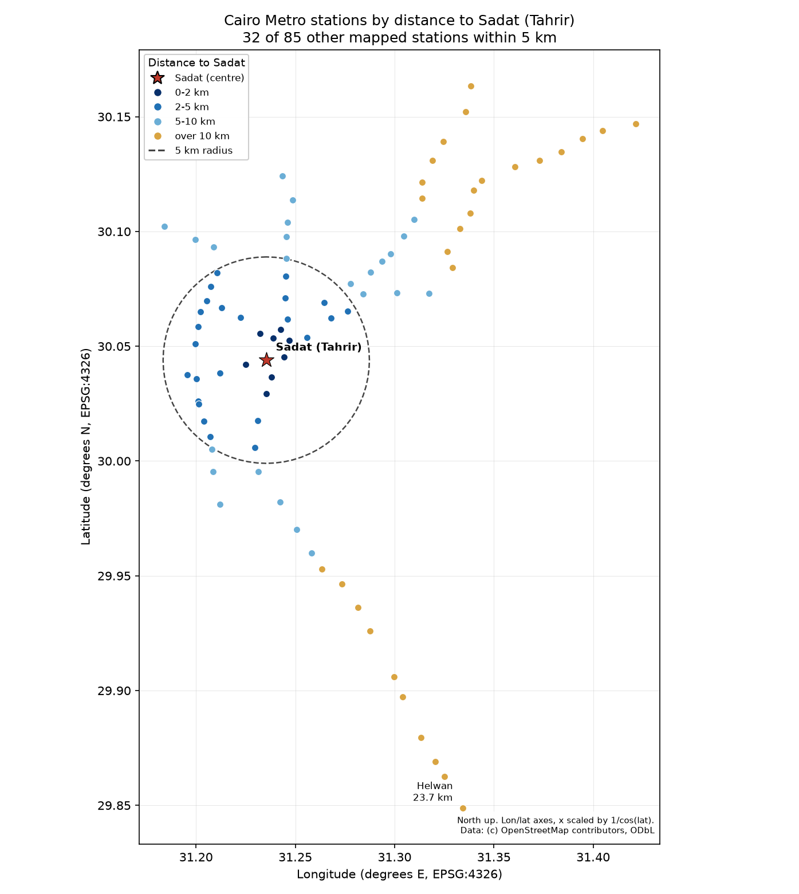

# Cairo Metro stations within 5 km of Sadat

## Question

Which Cairo Metro stations lie within 5 km of Sadat (Tahrir), the central interchange, and how far is each one?



- Web map: [index.html](index.html) (Leaflet; serve the folder with `python -m http.server` so the page can load `map.geojson`)
- Notebook: [showcase.ipynb](showcase.ipynb)
- Result as GeoJSON: [map.geojson](map.geojson)

## Data

- Source: OpenStreetMap, queried once through the Overpass API
  (`https://overpass-api.de/api/interpreter`) with
  `node["railway"="station"]["station"="subway"](29.8,31.0,30.2,31.6);out;`
  (bounding box south, west, north, east in degrees around Greater Cairo).
- License: ODbL 1.0, (c) OpenStreetMap contributors
  (<https://www.openstreetmap.org/copyright>).
- Fetched: 2026-11-18 (Overpass data timestamp 2026-11-18T00:28:43Z).
- Files in `data/`: `overpass_raw.json` (the unmodified response, 86 nodes) and
  `cairo_metro_stations.csv` (one row per node: `osm_id`, `name`, `name_ar`, `latitude`,
  `longitude`). `name` is the OSM `name:en` tag, falling back to `int_name`, then `name`.
  Coordinates are copied unchanged.

## Method

1. `csv_to_geojson.convert_file("showcase/data/cairo_metro_stations.csv")` detects the
   `latitude`/`longitude` columns and returns a GeoJSON FeatureCollection of points
   (86 features, 0 rows skipped).
2. CRS: WGS 84 (EPSG:4326), coordinates in `[longitude, latitude]` order, degrees. No reprojection.
3. Distance to the Sadat station is the great-circle distance in kilometres
   (haversine on a sphere with the WGS 84 mean radius, 6371.0088 km), not planar maths on
   degrees. Against the ellipsoid this can differ by a few tenths of a percent.
4. Each station gets `dist_to_sadat_km`, a `band` (0-2, 2-5, 5-10, over 10 km) and
   `within_5km`. A 5 km circle around Sadat is added as a polygon (72 segments, counter-clockwise
   exterior ring) using the matching spherical destination formula.

## Results

From the real output (85 stations other than Sadat itself):

- 32 stations are within 5 km of Sadat; 8 are within 2 km.
- The nearest is Saad Zaghloul (0.86 km), then Mohamed Naguib (0.87 km).
- The farthest is Helwan, 23.69 km to the south-east.
- The median distance is 6.78 km, so more than half of the mapped stations lie outside the 5 km circle.

Caveats: the file holds every OSM node tagged as a subway station in the box, without a filter
on opening status, and some stations appear as two nodes (for example Cairo University and
El-Dabaa Axis), so the counts are of mapped nodes, not of distinct stations. Metro line
membership is not in the data and is not used. Distances are straight-line, not along the tracks.

## Rebuild

```
python showcase/make_showcase.py
```

Runs offline from `data/` and rewrites `map.geojson`, `map.png` and `index.html`
(`map.png` needs matplotlib). `tests/test_showcase.py` checks that the committed `map.geojson`
and `index.html` match a fresh build. The notebook was executed and saved with its outputs;
re-run it from the repository root, e.g.
`python -m jupyter nbconvert --to notebook --execute --inplace showcase/showcase.ipynb`.
